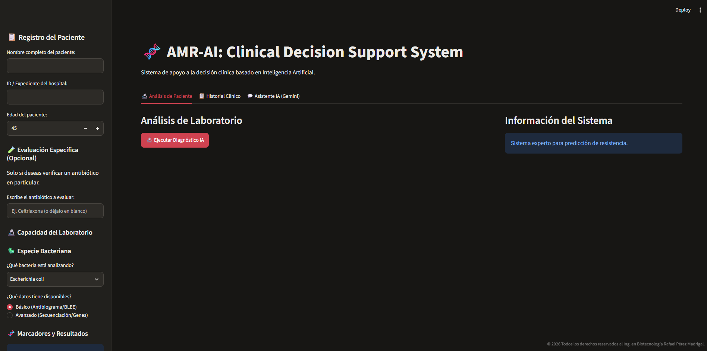
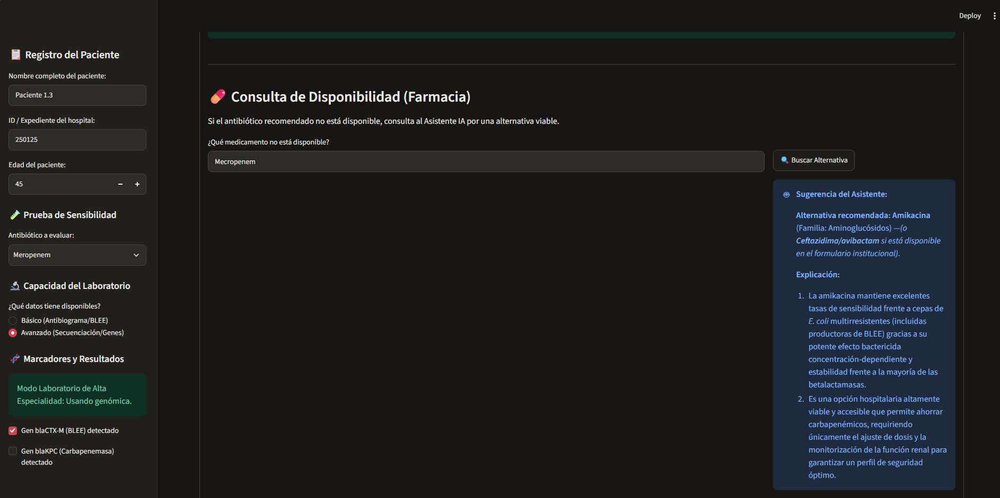
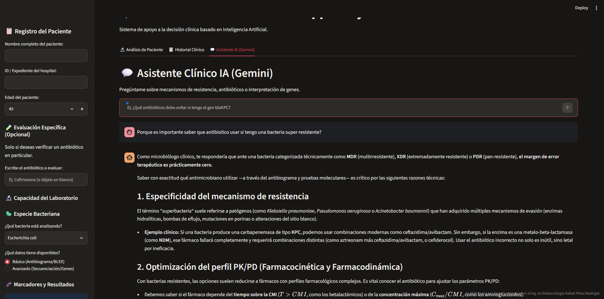

# 🧬 AMR-AI Clinical Decision Support System (v3.0)

An advanced, open-source Clinical Decision Support System (CDSS) designed to combat Antimicrobial Resistance (AMR). This project integrates Machine Learning, Genomic Data, and Generative AI to assist healthcare professionals in real-time.

## 🚀 Features

1. **Dual-Model Architecture (Adaptive):**
   *   **Basic Mode (Phenotypic):** Uses a Random Forest trained on 92,000+ clinical records to predict resistance from antibiograms.
   *   **Advanced Mode (Genomic):** Uses multi-label Random Forest models trained on real genomic data from the EMBL-EBI (5,400+ genomes) to predict resistance based on specific genetic markers (*blaCTX-M*, *blaKPC*).
2. **Multi-Bacteria Support:** Currently supports *Escherichia coli* and *Klebsiella pneumoniae*.
3. **AI Pharmacist (Gemini Integration):** If a recommended antibiotic is out of stock, the system uses Google's Gemini LLM to suggest viable alternatives based on the patient's genetic profile.
4. **Clinical AI Chatbot:** An integrated assistant powered by Gemini to answer complex questions about resistance mechanisms and pharmacology in real-time.
5. **Patient Database:** Every report is saved with a unique folio in a local SQLite database for traceability.

## 📸 Screenshots

**Clinical Summary & AI Recommendation:**

**AI Pharmacist Integration (Gemini):**

**Clinical AI Chatbot:**

## 🛠️ Technologies Used
*   **Python 3 & Streamlit** (Web App)
*   **Pandas & Scikit-Learn** (Data Processing & Machine Learning)
*   **Biopython & EMBL-EBI Datasets** (Genomic Data)
*   **Google Gemini API** (Generative AI)
*   **SQLite** (Database)

## 💻 How to Run
1. Clone this repository.
2. Install dependencies: `pip install streamlit pandas scikit-learn google-generativeai joblib`
3. Add your Google Gemini API Key in `app_web.py`.
4. Run the app: `python -m streamlit run app_web.py`

## 🌐 Language & Context Note
The user interface is in Spanish, as it simulates the clinical workflow and the Basic Formulary (Cuadro Básico) of Mexican public hospitals. The AI models and the narration for the video are in English for international reach.
